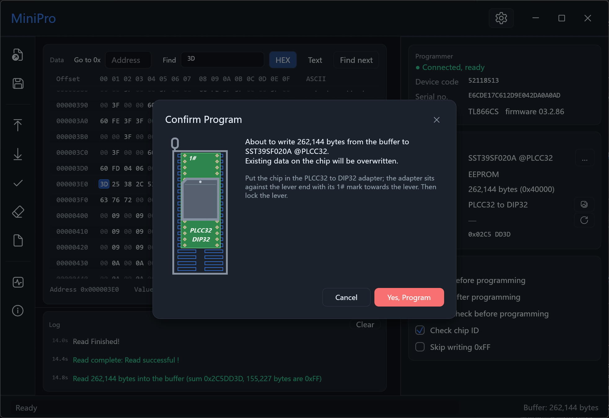

# minipro-winusb

Run the official **MiniPro v6.85** on Windows 11 with the programmer bound
to the Microsoft **WinUSB** driver, and use a redesigned front end on top of it.

Windows 11 blocks the 2012 `MiniProWdf` kernel driver that MiniPro needs (HVCI / vulnerable-driver blocklist,
Code 39).  This project keeps the **official program as the engine** — all programming algorithms, the chip
database and the protocol are the official ones — and replaces two things around it:

1. **the USB layer**: a DLL injected into `MiniPro.exe` that redirects its driver calls to WinUSB;
2. **the user interface**: `minipro-ui.exe`, a new GUI that drives the official program while it runs hidden.

`MiniPro.exe` itself is never modified and is not included in this repository.



## Contents

| Part | What it is |
|---|---|
| `shim/` | `minipro_winusb.dll` — the injected WinUSB shim, plus the *headless engine* mode and its control pipe |
| `launcher/` | `minipro-launch.exe` — starts `MiniPro.exe` suspended, injects the DLL, resumes it |
| `ui/` | `minipro-ui.exe` — the new front end (Rust + egui) |

## Requirements

* Windows 10/11, 32-bit or 64-bit (everything here is built 32-bit, like `MiniPro.exe`)
* the official **MiniPro v6.85** installed (not included), e.g. `C:\Users\<you>\Apps\MiniPro`
* a **TL866CS** programmer (USB `04D8:E11C`), bound to **WinUSB** once with [Zadig](https://zadig.akeo.ie/)
* to build: Rust with the `i686-pc-windows-msvc` target

Only the TL866CS has been tested.

## Two ways to use it

Both start from the same setup:

1. Bind the programmer to WinUSB with Zadig (once).
2. Build (see [Build](#build)) and copy **three files** into the MiniPro install directory, next to `MiniPro.exe`:
   `minipro-ui.exe`, `minipro-launch.exe`, `minipro_winusb.dll`.

Then pick one of the two:

| | Run | What you get |
|---|---|---|
| **A. The original program, fixed** | `minipro-launch.exe` | the **official MiniPro window**, unchanged, working again with the WinUSB driver |
| **B. The new interface** | `minipro-ui.exe` | the **redesigned GUI**; the official program runs hidden in the background as its engine |

* **A** is for when you want the familiar original window.  The launcher starts the `MiniPro.exe` next to it
  and loads the `minipro_winusb.dll` next to it (it looks nowhere else); extra command-line arguments are passed
  on to `MiniPro.exe`.
* **B** starts everything by itself — it launches the official program hidden, talks to it, and closes it when
  you quit.  You never start `MiniPro.exe` or the launcher yourself.
* Run only one of them at a time: both use the same programmer.

The shim writes a log of every USB transfer to `minipro_winusb.log` next to the DLL (overwritten each run).

## Self-test without mouse or desktop

The UI can run a script of steps, so it can be tested without synthetic mouse input or desktop screenshots
(screenshots come from egui's own framebuffer).  `MINIPRO_UI_SCRIPT` holds `;`-separated steps, e.g.

```
wait:2;idle;read;idle;verify;idle;shot:C:\x.png;quit
```

Steps: `wait:<s>`, `idle`, `shot:<png>`, `quit`; chip operations `read`, `verify`, `blank`, `identify`,
`selfcheck`, `restart`, `program`, `erase` (the last two skip the confirmation — test only), `load:<file>`,
`savebuf:<file>`, `select:<chip name>`, `poke:<addr>:<byte>` (edit one buffer byte); view `theme:auto|light|dark`, `lang:en|zh`, `zoom:<factor>`, `settings`,
`about`, `confirm`, `askselfcheck`, `picker:<text>`, `closepicker`, `goto:0x100`, `find:<hex bytes>`;
placement-diagram development aids `socket`, `socketpng:<png>`, `socketgrid:<chip>|<chip>|…`, `socketview`
(each `…:off` closes).  `MINIPRO_UI_LOGFILE` dumps the log on `quit`.  `MINIPRO_UI_SOCKET_PNG` /
`MINIPRO_UI_SOCKET_FULL` are for the `capture` comparison work.  Note that `theme:`/`lang:`/`zoom:` also save
the setting.  `program`, `erase` and `selfcheck` only run in a build with `--features selftest`; release builds
refuse them.

## Build

```
rustup target add i686-pc-windows-msvc
cargo build --release          # builds shim, launcher and ui; 32-bit, like MiniPro.exe
```

Output is in `target\i686-pc-windows-msvc\release\`: `minipro-ui.exe`, `minipro-launch.exe`,
`minipro_winusb.dll`.  Copy them next to `MiniPro.exe`.  (The build is configured in `.cargo/config.toml`: 32-bit
target, static CRT so the DLL does not depend on VC runtimes inside a 2018-era process.)

## Status

Hardware-tested with an SST39SF020A in the socket, through the new front end: read, program (erase + program +
verify), verify, blank check (both results), chip ID, programmer self-check, chip selection, re-launch of the
engine.  Not tested: the stand-alone erase button, any programmer other than a TL866CS, chips other than the
SST39SF020A (the placement diagram was compared against the official pictures, not against real chips), and the
mouse interactions of the front end (it was driven by the self-test script and checked by screenshots).

## Caveats

* If Zadig is run again the WinUSB interface GUID changes; the shim re-reads it, no rebuild needed.
* Do **not** use MiniPro's firmware-update / bootloader functions through the shim; they use the same channel
  and a mistake there can brick the programmer.  Use the official tool on a machine with the old driver for that.
* The DLL and the launcher are unsigned; antivirus software may flag the process injection.
* The official program is not distributed here; you need your own copy of MiniPro v6.85.

## License

[MIT](LICENSE).  This covers the code in this repository only; the official MiniPro program is not part of it
and stays under its own terms.
